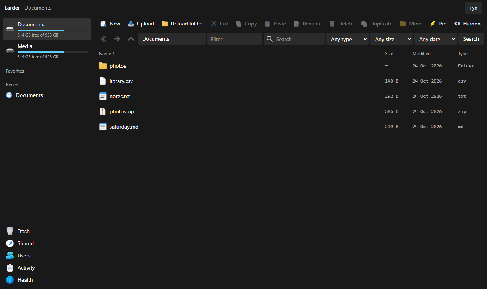
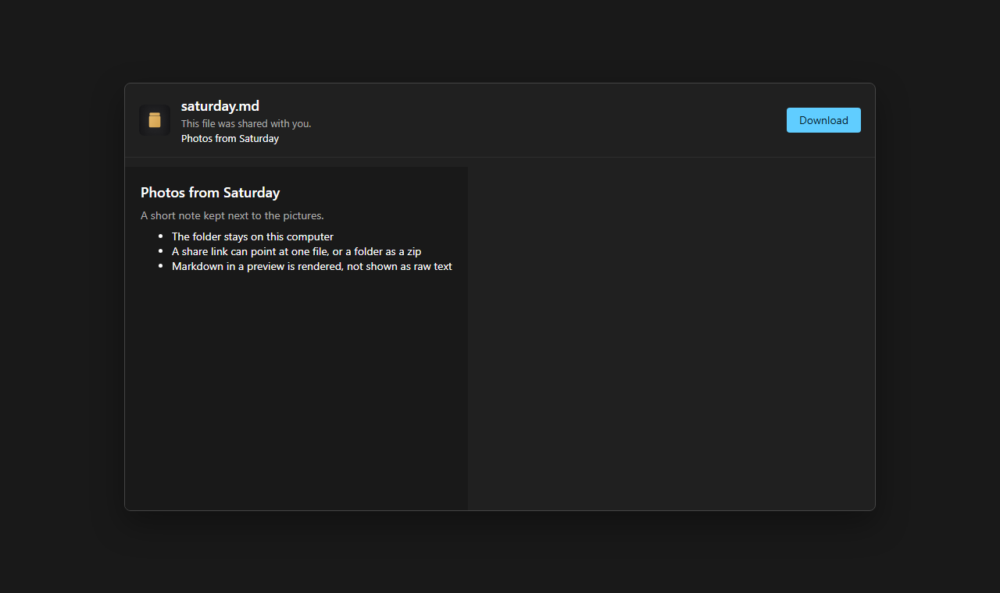
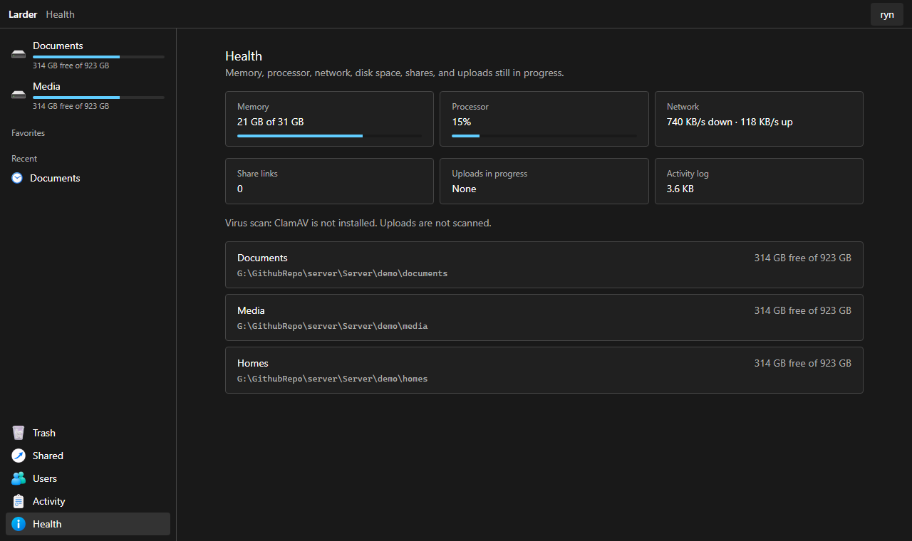

<p align="center">
  
</p>

<h1 align="center">Larder</h1>

<p align="center">
  A self-hosted file manager for the folders already on your computer.
</p>

Larder runs on the machine that holds the files. You open it in a browser, on that machine or another one on the network, and work with those folders directly. There is no database and no second copy of the files. What you configure is what you see.



Admins can open a terminal in the browser after entering their password again. It is a shell on the machine, as the account that runs Larder, and it starts in the folder that is open.

## What you can do

- Sign in with an account. The first visit creates the admin. Each person can have view or edit access to a folder, or share that access through a group. The higher access is the one that applies. Each person can also have a private vault named after them, such as Ryns Vault.
- Browse, filter, and search by name, type, size, or date. Search can cover every folder the account can open. Sort by name, date, size, or type, remembered per folder. Show or hide dotfiles. Right-click a folder and choose Password Protect to ask for a password before it opens.
- Preview images, audio, video, PDF, and text. Markdown is rendered, and CSV is shown as a table. Edit text in the browser. Video files get a thumbnail when ffmpeg is installed.
- Upload files, or a whole folder with its structure. Paste a picture from the clipboard. An upload that drops can continue where it stopped. Download a file, or a selection as a zip, and extract a zip in place.
- Rename, duplicate, copy, and move, including between folders. Delete goes to trash. Trash can be removed automatically after a chosen number of days.
- Share a file, or a folder as a zip. A folder can also have an upload link, so someone can add files without an account. A link can have an address you choose, a short note, a password, an expiry, and a QR code. You can change those without making a new link, see when it was opened, and save one file out of a shared zip. Leave the address blank for a long random link.
- Invite someone with the folder access you already picked. The invite creates their account. Unused invites stay listed, with their link, until they are used or revoked.
- On the admin Health page, see free space, memory, processor, network, shares, uploads still in progress, and the activity log. A disk that is nearly full is marked. The activity log keeps the latest 5,000 lines.





## Requirements

- Node.js 22 or newer

## Run it here

```bash
npm install
copy larder.config.example.json larder.config.json
npm run dev
```

On Linux and macOS, use `cp` instead of `copy`.

Open http://localhost:5173. The first page asks you to create the admin account. The password needs at least 12 characters.

`npm run dev` starts the API and the page. The page proxies `/api`, `/s/`, and `/join/` to the API. Those proxy targets in `vite.config.ts` must use the same port as `larder.config.json`. The example config listens on port 8787. This checkout proxies to 8788, because 8787 was already in use on the development machine.

The example config shares `demo/documents` and `demo/media`. Point `roots` at the real directories when you are ready. Paths may be absolute, or relative to the config file. `trashDays` is how long deleted files stay, in days. Leave it `null` to keep them until trash is emptied. An admin can also choose 7, 30, or 90 days from the trash page.

## Run it on the server

```bash
npm install
npm run build
npm start
```

`npm start` serves the built page and the API from the host and port in `larder.config.json`. Set `host` to a LAN address, or to `0.0.0.0` in Docker. Put Caddy or nginx in front when it should be reached over HTTPS, and leave Larder bound to localhost in that case.

`larder.config.json` holds the password hashes and the session secret. It is gitignored. Do not commit it. `data/` holds sessions, share links, invites, and uploads that are still in progress.

If ClamAV is installed (`clamdscan` or `clamscan`), new uploads are scanned. If it is not installed, uploads proceed as usual. Video thumbnails use ffmpeg when it is on the machine.

### Docker

The config path inside the container has to be the path you mount, and each shared folder has to be mounted at the path named in the config.

```bash
docker build -t larder .
docker run --rm -p 8787:8787 \
  -v /opt/larder/larder.config.json:/opt/larder/larder.config.json \
  -v /opt/larder/data:/opt/larder/data \
  -v /srv/documents:/srv/documents \
  larder
```

Set `host` to `0.0.0.0` in that config so the published port reaches the process.

### systemd

On the Linux machine, Node.js 22 is installed and the app lives in `/opt/larder`. The `larder` user needs to be able to read and write the folders in the config. Run `npm install` and `npm run build` in `/opt/larder` before the service starts.

```bash
sudo useradd --system --home /opt/larder --shell /usr/sbin/nologin larder
sudo mkdir -p /opt/larder
sudo cp deploy/larder.service /etc/systemd/system/larder.service
sudo systemctl daemon-reload
sudo systemctl enable --now larder
```

The unit file runs `npm start` as that user, with `LARDER_CONFIG=/opt/larder/larder.config.json`.

## Known limits

These are the things still worth handling on a live server.

- An empty server lets the first person who opens it create the admin. Create that account before a tunnel or a VPN is switched on.
- A share address you choose, such as `saturday`, is short enough to guess. A link with no password is the file. Leave the address blank when the link should be hard to find, and put a password on anything private.
- The Docker image runs as root. The systemd service runs as the `larder` user.
- With Caddy or nginx in front, Larder still sees plain HTTP from localhost. The session cookie is marked Secure only when the request Larder itself receives is HTTPS, and the login slowdown is counted against the proxy rather than each visitor.
- HEIC photos can be previewed only when the server can read them. The length of an audio or video file is shown when `ffprobe` is installed. The download is still the original file.

## Ideas

Not built yet, and useful later: opening a folder over WebDAV, a second step at sign-in, a size limit on a folder grant, and changing permissions on Linux.

Editing Office documents, a photo library, and searching inside file contents are outside what Larder is for.

If you hit a bug, or you want one of those, message Ryn on Discord at Rynfreshly.

## Tests

```bash
npm test
```

## License

MIT. See [LICENSE](LICENSE).
